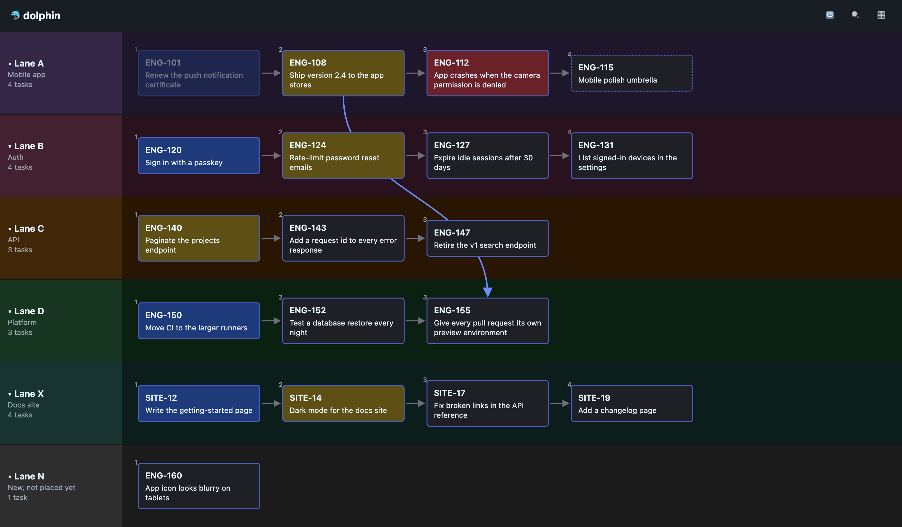

# 🐬 dolphin

A local companion page that splits my open tasks (Linear, GitHub Projects) into parallel lanes, so I can work on
several tasks at the same time. Claude arranges the lanes through an MCP server; the page shows them.



_The screenshot shows the demo board from `bun run seed:demo`. Every task in it is made up._

## Run

Needs Bun 1.4.4 or later: `bun run typecheck` calls `bun check`, which older Bun versions do not have.

```sh
bun install                        # also installs the git hooks (see "Keep work names out of git")
cp dolphin.config.example.ts dolphin.config.ts   # then fill in your own values
bun run dev                        # http://dolphin.localhost:4747
```

To try it without any tracker:

```sh
bun run seed:demo                  # writes a made-up board to demo.db
bun run demo                       # http://dolphin.localhost:4750, no tracker calls, no backups
```

Open the page at http://dolphin.localhost:4747. Browsers send every `*.localhost` name to your own machine, so
it needs no `/etc/hosts` entry. Avoid `127.0.0.1`: YouTube refuses some embeds on a bare-IP address. The server
still listens on `127.0.0.1` only.

`bun run import path/to/data.json` loads a board snapshot. It replaces the whole board, so on a board that already
has lanes it stops unless you add `--force`.

## Stack and decisions

| Part | Choice | Why |
|---|---|---|
| Runtime | [Bun](https://bun.sh) and TypeScript | One tool for the server, SQLite, bundling, type checking and tests. No Node, no Vite. |
| Scope | Local only, one user, no auth, no hosting | A companion page next to my editor. Keep it simple. |
| Server | `Bun.serve` routes | Four routes do not need Hono or Elysia. |
| Page | [Preact](https://preactjs.com) 11 in TSX | Small, with a familiar React-like model to grow into. Bun's HTML import bundles the TSX, so no `htm` and no build step. |
| Styling | [Tailwind CSS 4](https://tailwindcss.com) and [DaisyUI 5](https://daisyui.com) | DaisyUI is CSS-only, so it works with Preact. shadcn needs React and Radix. Pico was the no-build option, with fewer components. |
| Database | SQLite through `bun:sqlite`, with [Kysely](https://kysely.dev) 0.29 | Typed queries and migrations, and a chance to learn Kysely. Drizzle (heavier) and hand-rolled `user_version` migrations were the other options. |
| MCP | `@modelcontextprotocol/sdk` over HTTP, on `/mcp` in the same process | The page and Claude share one process and one database. A stdio server would be a second process the page cannot hear. |
| Sync | A 🔁 button, on demand | I am the only one who moves my tasks, so polling and webhooks add nothing. |
| Dependencies | Set by hand or by Claude, never copied from Linear relations | Tracker relations across lanes read as noise. Someone has to decide which links matter. |
| Linear | GraphQL through `fetch`, key in the macOS Keychain | No SDK and no `.env` file. |
| GitHub | `gh api graphql` | Reuses the `gh` login, so no token to store. |
| Lane rules | Free text plus "pins", in the database, edited through MCP | Rules name real projects, so they stay out of git. A rule engine would be overkill. |
| Settings | `dolphin.config.ts`, git-ignored, typed by `defineConfig` | The tracker projects and the denylist are private. The example file is the documentation. |

## Page

The header has 3 buttons:

- 🔁 refreshes statuses from the trackers. A toast at the bottom left shows progress, then the changes.
- 🔍 opens the search box (also ⌘F). Enter and Shift+Enter step through the matches; Esc clears.
- 🎛️ opens the settings: theme `[💻|☀️|🌙]`, then `[🟢|🔴]` for titles, positions, in-lane blockers, completed, other cycles and legend, and privacy `[🙈|🙉]`.

With `completed` off, Done, Canceled and "Not found" tasks are hidden; with `other cycles` off, tasks planned for a
Linear cycle other than the current one are hidden. The other cards keep their position numbers, so they still match
the MCP's positions. A task in another cycle has a striped fill, a dotted violet border and its cycle number (`C42`) in
the top-right corner. A task with no cycle is not in another cycle. Click a lane header to collapse that lane to one thin row (`▸ Lane X · 15 tasks`); the other lanes take the freed
height, and a search match inside a collapsed lane expands it. The legend shows as a bar at the bottom. Privacy mode replaces task titles and lane names with solid bars and
hides the hover card, so a screenshot shows only task ids, statuses and the layout. It does not blur: blurred
text keeps the glyph shapes and can sometimes be recovered. Settings are kept in `localStorage`.

Alt + drag a card to move it by hand: a blue bar marks the gap it will drop into, before or after the card under the
pointer. Drop it on a lane header or a collapsed lane to put it at the end of that lane, or on lane N to unplace it.
Lane N shows during a drag even when it is empty, and a completed card cannot go there. The board scrolls when the
pointer nears its edge, and Esc cancels. A plain click still opens the task. The move is saved at once, the same as an
MCP `place_task`, and a toast shows any rule warning that names the moved card.

## Refresh

The 🔁 button (and the MCP `refresh` tool) pulls task statuses from Linear and from the GitHub project in `dolphin.config.ts`. It
writes titles, statuses and Linear cycles only: lanes, positions and dependencies stay as they are. A cycle move is
written but not listed as a change. Open tasks the board does not
know show in lane N. A refresh takes about 9 s, most of it waiting on GitHub.

- Linear reads a personal API key from `$LINEAR_API_KEY`, else from the macOS Keychain. Store it once:
  `security add-generic-password -s dolphin-linear-api-key -a "$USER" -w`
- GitHub uses the `gh` CLI and its existing login. Set the project in the `github` block of `dolphin.config.ts`:
  the organization, the project number, your login, the repository, the id prefix and the open status columns.
  Leave the block out to skip GitHub. `linear: false` skips Linear.
- Card colors come from the status: Linear's own names have a color, and `tones` in the config adds yours.

If one source fails, the other still applies, and the toast shows the error. A Linear task that Linear no longer
returns (deleted, or out of your key's reach) is closed with the status "Not found in Linear", so its card fades.

## MCP

Connect Claude Code to the MCP server:

```sh
claude mcp add --transport http dolphin http://127.0.0.1:4747/mcp
```

Tools:

- `get_board`: the rules, the lanes in order, the edges and the current rule warnings. Read it before arranging.
- `get_rules` and `set_rules`: the rules text Claude follows, and the pins. A pin keeps the tasks whose meta matches
  its `kind` and `app` in one lane, for example every release run in lane A.
- `refresh`: the same pull as the 🔁 button.
- `place_task` (id, lane, 1-based position), `reorder_lane` (lane, full id list), `unplace_task` (back to lane N).
- `add_edge` and `remove_edge` (blocker, blocked). A loop is rejected.
- `rename_lane` and `set_note`.

The API and MCP routes accept only requests addressed to `127.0.0.1`, `localhost` or `dolphin.localhost` on the
server's port, so a web page cannot reach them through DNS rebinding.

The page writes placements too: Alt + drag calls `POST /api/move`, which places the card next to the card it was
dropped by, so a page loaded before an MCP write still drops where the user aimed. Every write returns what it did and the rule warnings for the whole board: a blocker after the task it blocks,
a cross-lane blocker that is not earlier, and a pinned task outside its lane. Warnings never block a write.

## Database

Kysely runs on `bun:sqlite` through Kysely's built-in `SqliteDialect`. `src/db/bun-sqlite.ts` adapts the two
differences: Kysely passes parameters as one array and reads a `reader` flag. The community `kysely-bun-sqlite`
dialect pins Kysely 0.28, so it is not used. Migrations run when the server starts.

To change the schema:

1. Add `src/db/migrations/NNNN_name.ts` with `up` (and `down`), using `db.schema`.
2. List it in `src/db/migrations/index.ts`.
3. Update the row types in `src/db/schema.ts`.

Never edit a migration that already ran on your `dolphin.db`; write a new one. In Kysely 0.29, `Migrator` and
`Migration` come from `kysely/migration`.

## Backup

The database lives on your machine only. The server copies it once a day, at start and after a refresh, to
`<dir>/YYYY-MM-DD/dolphin.db` with your `dolphin.config.ts` next to it, and keeps the newest 14 days. The default
`<dir>` is `~/Library/Mobile Documents/com~apple~CloudDocs/dolphin`, so iCloud Drive syncs it. Set `backup` in the
config to change the folder or the count, or `backup: false` to turn it off. `bun run backup` writes today's copy now.

To restore, stop the server, then copy a backup over `dolphin.db` and delete `dolphin.db-wal` and `dolphin.db-shm`.

## Keep work names out of git

Task titles, rules and project names stay in `dolphin.db` and `dolphin.config.ts`, which git ignores. The
`denylist` in the config lists the words that must never reach a commit: your employer, clients and projects.
`bun install` copies two hooks from `.githooks/` into `.git/hooks/`: `pre-commit` scans the added lines and
`commit-msg` scans the message. `bun run check:private` scans every tracked file.

## Styling

`bun-plugin-tailwind` (in `bunfig.toml`) builds the CSS for the HTML import. `src/web/app.css` loads Tailwind and
DaisyUI, then `board.css`, the board's own look: lanes, cards and arrows. DaisyUI covers the controls (`btn`, `join`,
`dropdown`, `input`, `toast`, `alert`, `loading`).

- The theme setting sets `data-theme` on `<html>`. DaisyUI and `board.css` both read it.
- Do not name a CSS variable after one DaisyUI uses, such as `--border` or `--size`: the controls break.
- `bun --hot` does not rebuild the CSS when only `board.css` changes. Restart the server.

## Test

```sh
bun test   # runs on an in-memory database (test-setup.ts), never on dolphin.db
```

## Layout

- `src/server/`: `index.ts` (the `Bun.serve` routes: `/`, `/api/board`, `POST /api/refresh`, `POST /api/move`, `/mcp`), `mcp.ts` (the MCP
  tools) and `guard.ts` (the Host/Origin check every API and MCP route goes through).
- `src/core/`: the board logic, with no HTTP. `board.ts` reads the board, `arrange.ts` holds the writes behind the MCP
  tools and the page's drag and drop, and the rule checks; `order.ts` is the move's list step, shared with the page; `refresh.ts` applies tracker facts, `rules.ts` reads and writes the lane rules, `backup.ts` writes the daily copy. Tests sit next to them.
- `src/sources/`: one fetcher per tracker (Linear, GitHub).
- `src/db/`: the Kysely setup, the `bun:sqlite` adapter, the row types and `migrations/`.
- `src/scripts/`: `import.ts` loads a `data.json` snapshot (it refuses to replace a board that has lanes unless you
  add `--force`), `seed-demo.ts` writes the demo board, `backup.ts`, `check-private.ts` and `install-hooks.ts`.
- `src/config.ts` loads `dolphin.config.ts`; `src/define-config.ts` holds its types.
- `src/web/`: the Preact page. `app.tsx` is the layout; `hooks/` holds the state (board, search, collapsed lanes,
  display settings) and `components/` the parts of the page. `app.css` is the CSS entry; `board.css` holds the
  board styles.
- `src/types.ts`: the types shared by the server and the page.

Task facts (title, status) come from the trackers. Lanes, positions and dependencies are set by hand or by Claude.
`dolphin.db`, `dolphin.config.ts` and `data*.json` hold work data and are git-ignored.

## License

[MIT](LICENSE).
